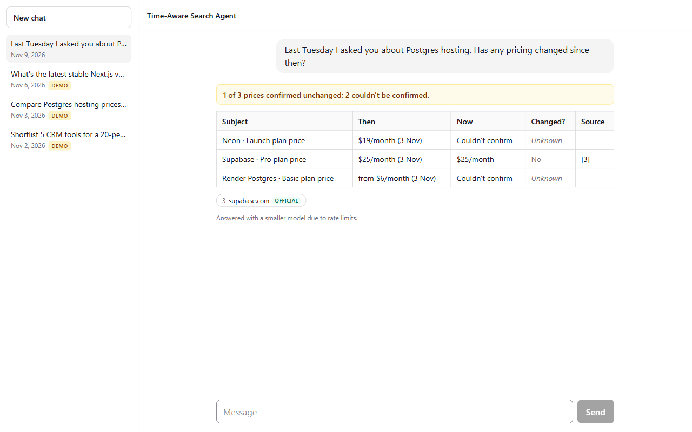
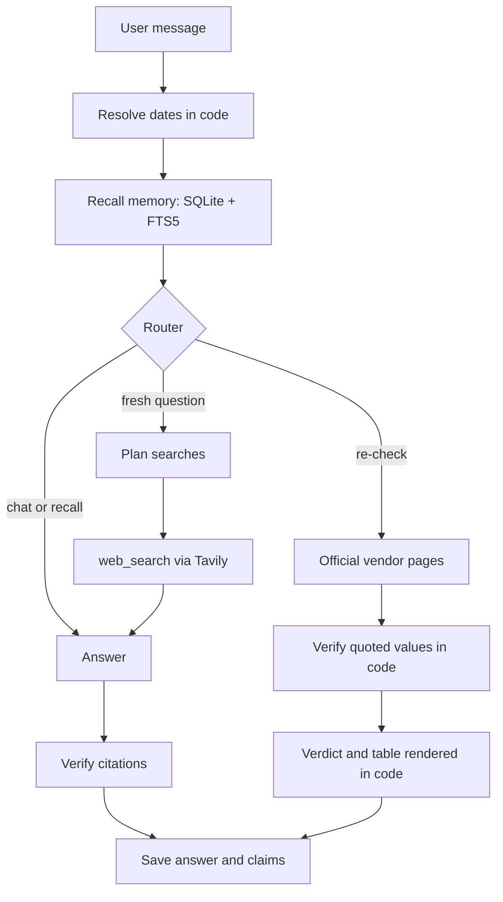
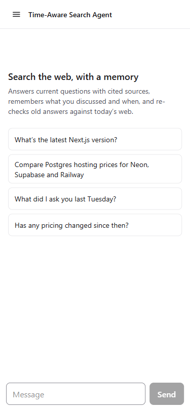
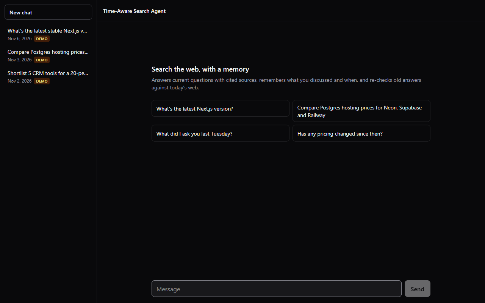
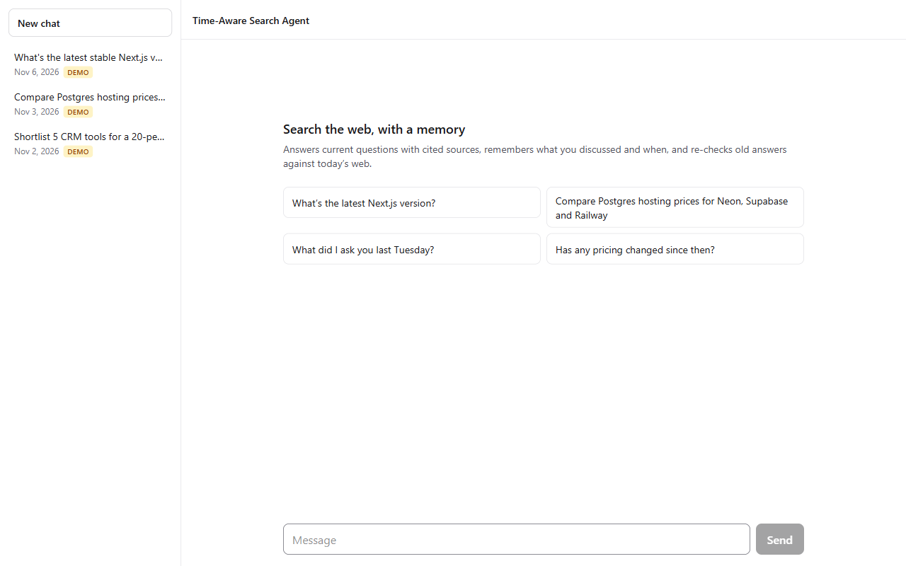

# Time-Aware Search Agent

A web-search chat agent that remembers what it told you, and when, and re-checks it against today's web.

[](https://github.com/EXCALIBUR-cmd/Time-aware-search-agent/actions/workflows/ci.yml)


Built for the minimi hiring challenge.



*"Last Tuesday I asked you about Postgres hosting. Has any pricing changed since then?" on the demo data: recalled from 3 Nov, re-checked against official pages.*

## Why it's different

- **Dated memory with claims.** Every answer is stored with its date, and each price or fact it cited is stored as a claim with its source.
- **Date maths in code, not the model.** "Last Tuesday" becomes an exact date range before the model sees the message.
- **Re-checks against official vendor pages.** The model must quote its evidence; code checks that the quote is on the page and contains the value, then decides what changed.
- **Honest gaps.** No memory for a date gives "no record", not a guess. Unclear evidence gives "Couldn't confirm".

## How it works



Memory is recalled before routing, so the router knows what is in memory. Every decision, and the alternatives that were rejected, is argued in [DESIGN.md](DESIGN.md).

## Results

| What | Measured |
|---|---|
| Eval scenarios | 8/8 passed, paced to stay under free-tier rate limits |
| Router accuracy on 18 labelled messages | 15/18 → 18/18 |
| Prompt tokens over three search questions | 9,481 → 5,148 (46% fewer) |
| Time to first answer token, one question | 7.3 s → 2.3 s (single run) |
| Token estimate vs Groq's count | Exact on first answer steps (506 vs 506); 5 to 7% high after a follow-up search |
| CI | macOS, Linux and Windows, Node 22 and 24 |

A re-check caught a stale figure: a third-party site said Railway Hobby includes 1 GB of Postgres storage; Railway's own docs say 5 GB.

## Quick start

1. Install. Needs Node.js 22 or newer; the SQLite driver ships prebuilt, so no compiler is needed.

   ```
   npm install
   ```

2. Copy `.env.example` to `.env` and fill in `GROQ_API_KEY` and `TAVILY_API_KEY`. Every other setting is optional.

   ```
   cp .env.example .env
   ```

3. Start the app and open http://localhost:3000.

   ```
   npm run dev
   ```

`npm run dev` uses `data/agent.db`, which starts empty and holds only your own conversations.

## Try the memory features

Memory questions need a past, so the repo ships one:

```
npm run demo
```

Then ask, each in a new chat:

| Ask | What you should see |
|---|---|
| "On Monday we shortlisted 5 CRM tools for a 20-person sales team. Has any of them changed pricing or shipped something big since?" | The five tools recalled from 2 Nov, searched again, and a Then / Now / Changed? table |
| "What did I ask you on 3 November? Is your answer still correct today?" | The Postgres question and its answer, with each price re-checked |
| "Last Tuesday I asked you about Postgres hosting. Has any pricing changed since then?" | A was / now / changed table with sources |
| "What did we discuss last week?" | The three conversations, with their dates |
| "What did I ask you on 1 October?" | No record, said plainly, with an offer to look it up now. Nothing invented |

<details>
<summary>What <code>npm run demo</code> does</summary>

- It writes three past conversations into a separate database, `data/demo.db`: a CRM shortlist (Mon 2 Nov 2026), Postgres hosting prices (Tue 3 Nov) and the Next.js version (Fri 6 Nov), each with its claims and sources. They carry a "Demo" tag in the sidebar. Your own `data/agent.db` is never touched.
- It starts the app on that database with the clock fixed to Monday 9 November 2026, 10:00 IST (`AGENT_NOW=2026-11-09T10:00:00+05:30`), so "last Tuesday" is 3 Nov and "last week" is 2 to 8 Nov. A blue banner under the header shows the demo clock.
- Chats you have in the demo are saved in `data/demo.db` and survive a restart. Running `npm run demo` again resets only the three tagged conversations.
- The demo clock is a Monday, so "Monday" can mean 2 Nov or the demo's today; the agent recalls both and shows the dates.
- To go back to the real clock and your own history, stop the demo and run `npm run dev`.

</details>

<details>
<summary>The "Today" clock control</summary>

In dev mode (`npm run dev` and `npm run demo`) the header has a "Today" control.

- When nothing is picked, it shows the clock the server is using: real time, or `AGENT_NOW` when that is set.
- Pick any past date and time and the agent treats it as now for date phrases, the prompt and the timestamps of new messages. Web search still reads today's web.
- A picked date is remembered in the browser and wins over `AGENT_NOW`. A banner offers "Reset to real time", or "Reset to demo clock" in the demo.

</details>

## Screenshots

<table>
  <tr>
    <td align="center" width="30%">
      
      <br><sub>375 px: the sidebar collapses into a drawer</sub>
    </td>
    <td align="center" width="70%">
      
      <br><sub>Dark mode follows the system setting</sub>
    </td>
  </tr>
</table>

<details>
<summary>Empty state in light mode</summary>



</details>

## Scripts

| Command | What it does |
|---|---|
| `npm run dev` | Starts the app on `data/agent.db` with the real clock |
| `npm run demo` | Seeds `data/demo.db` and starts the app on it with the clock fixed to 9 Nov 2026 |
| `npm test` | Unit tests with mocked models and search; no API keys needed |
| `npm run seed` | Only writes the demo history into `data/demo.db` (`demo` already does this) |
| `npm run eval:router` | Routes 18 labelled messages with the live router and prints accuracy and latency. Needs `GROQ_API_KEY` |
| `npm run eval` | Replays 8 scenarios against the agent on an in-memory database holding the demo history, and prints a pass/fail table with time to first token. Never touches `data/`. Needs both keys |

## Project structure

The agent is plain TypeScript in `lib/`; Next.js is only the shell around it.

```
lib/
├── time/          "last Tuesday" → an exact date range, in code
├── memory/        SQLite store: messages, claims with sources, user facts, FTS5 recall, prompt blocks
├── search/        Tavily client, the web_search tool, official-page ranking, table flattening
├── agent/         router, turn planning, prompt, streaming answer, citations, re-checks, model fallback
├── citations.ts   which sources an answer cites, shared with the UI
├── verdict.ts     which verdicts report a confirmed change
└── config.ts      environment settings and the agent's clock
```

`data/` holds the databases. They are created on first use and are not committed.

## Known limits

- Groq's free tier allows 8,000 tokens per minute per model. Under load the agent answers with a smaller model and says so.
- Memory search is by keyword (SQLite FTS5); there are no embeddings yet, so synonyms are missed.
- Some prices come back "Couldn't confirm" by design: a value counts only when its quote is found on the page.

---

Built with Claude as a coding assistant; I can walk through any part of it. The reasoning behind each decision is in [DESIGN.md](DESIGN.md).
